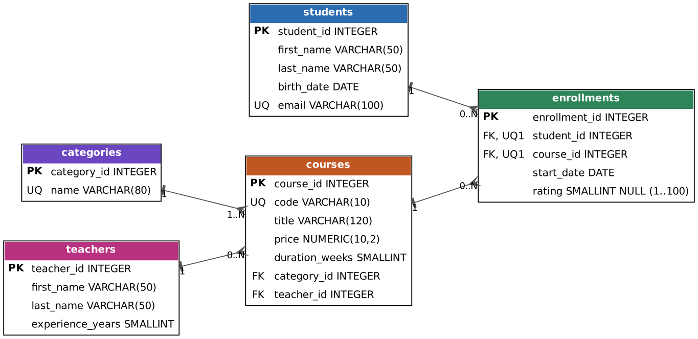
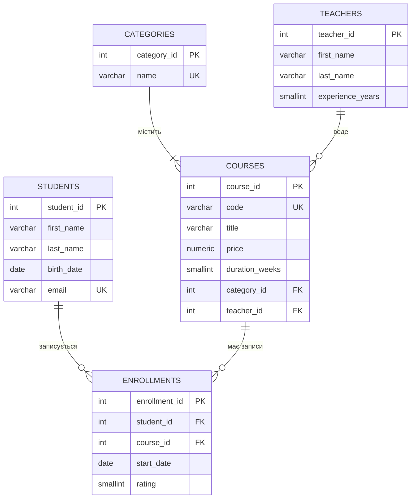

# Проєктування БД для платформи онлайн-курсів (PostgreSQL)

## Структура репозиторію

```
.
├── README.md              # опис, ФЗ, потенційні ключі, обґрунтування 3НФ
├── erd/
│   ├── erd.png            # ERD (зображення)
│   ├── erd.svg            # ERD (вектор)
│   └── erd.dot            # вихідник ERD (Graphviz)
└── sql/
    ├── 01_schema.sql      # таблиці, типи, обмеження, зв'язки, тригер
    ├── 02_data.sql        # тестові дані
    └── 03_queries.sql     # запити 1–16 (у т.ч. представлення, запит 2)
```

## Запуск

```bash
createdb online_courses
psql -d online_courses -f sql/01_schema.sql
psql -d online_courses -f sql/02_data.sql
psql -d online_courses -f sql/03_queries.sql
```

## ERD





Зв'язки:
- `categories 1 — N courses` (курс має рівно одну категорію);
- `teachers 1 — N courses` (курс має одного викладача, викладач може вести кілька курсів);
- `students M — N courses` реалізовано через таблицю `enrollments`.

## Таблиці, типи даних та обмеження

| Таблиця | Призначення | Ключові обмеження |
|---|---|---|
| `students` | студенти | `PK(student_id)`, `UNIQUE(email)`, `CHECK(birth_date <= CURRENT_DATE)`, перевірка формату email |
| `teachers` | викладачі | `PK(teacher_id)`, `CHECK(experience_years >= 0)` |
| `categories` | категорії курсів | `PK(category_id)`, `UNIQUE(name)` |
| `courses` | курси | `PK(course_id)`, `UNIQUE(code)`, `CHECK(code ~ '^[A-Z]{2,4}[0-9]{3}$')`, `CHECK(price >= 0)`, `CHECK(duration_weeks > 0)`, `FK(category_id)`, `FK(teacher_id)` |
| `enrollments` | записи студентів на курси | `PK(enrollment_id)`, `UNIQUE(student_id, course_id)`, `CHECK(rating BETWEEN 1 AND 100)`, `rating NULL`, `FK(student_id)`, `FK(course_id)` |

Додатково:
- **`rating` = `NULL`**, поки студент не поставив оцінку (оцінка необов'язкова).
- **Тригер `trg_enrollments_rating`** не дозволяє записати оцінку, поки курс не завершився
  (`start_date + duration_weeks * 7 > CURRENT_DATE`). `CHECK` не може звертатися до іншої таблиці, тому використано тригер.
- **Дата завершення не зберігається**, вона обчислюється: `start_date + duration_weeks * 7`.

## Функціональні залежності та потенційні ключі

Позначення: `A → B` — B функціонально залежить від A.

### `students(student_id, first_name, last_name, birth_date, email)`
- Потенційні ключі: `{student_id}`, `{email}`.
- ФЗ:
  - `student_id → first_name, last_name, birth_date, email`
  - `email → student_id, first_name, last_name, birth_date`
- Ім'я та прізвище не є ключем (можуть бути тезки), тому `{first_name, last_name}` ключем не вважається.

### `teachers(teacher_id, first_name, last_name, experience_years)`
- Потенційний ключ: `{teacher_id}`.
- ФЗ: `teacher_id → first_name, last_name, experience_years`.

### `categories(category_id, name)`
- Потенційні ключі: `{category_id}`, `{name}`.
- ФЗ: `category_id → name`, `name → category_id`.

### `courses(course_id, code, title, price, duration_weeks, category_id, teacher_id)`
- Потенційні ключі: `{course_id}`, `{code}`.
- ФЗ:
  - `course_id → code, title, price, duration_weeks, category_id, teacher_id`
  - `code → course_id, title, price, duration_weeks, category_id, teacher_id`
- Назва категорії та дані викладача не повторюються в `courses`: вони доступні через `category_id` і `teacher_id`.

### `enrollments(enrollment_id, student_id, course_id, start_date, rating)`
- Потенційні ключі: `{enrollment_id}`, `{student_id, course_id}`.
- ФЗ:
  - `enrollment_id → student_id, course_id, start_date, rating`
  - `student_id, course_id → enrollment_id, start_date, rating`
- Дата завершення `end_date` у таблиці відсутня: вона виражається через `start_date` та `duration_weeks` з `courses`
  (`course_id → duration_weeks`), тому її збереження створило б надлишковість.

## Обґрунтування відповідності 3НФ

Таблиця у 3НФ, якщо вона у 2НФ і жоден неключовий атрибут не залежить транзитивно від ключа (кожен неключовий атрибут залежить «від ключа, від усього ключа і лише від ключа»).

1. **1НФ.** Усі атрибути атомарні: ім'я та прізвище окремо, немає списків чи повторюваних груп (курси студента — окремі рядки в `enrollments`).
2. **2НФ.** Складений потенційний ключ є лише в `enrollments` (`{student_id, course_id}`). Неключові атрибути `start_date` і `rating` залежать від **усього** ключа, тобто від конкретного запису студента на курс, а не від студента чи курсу окремо. В інших таблицях ключ простий, тож часткових залежностей немає.
3. **3НФ.** Транзитивних залежностей неключових атрибутів немає:
   - у `courses` категорія та викладач винесені в окремі таблиці. Якби в `courses` зберігались `category_name` чи `teacher_last_name`, виникла б залежність `course_id → category_id → category_name`; це усунуто виокремленням `categories` і `teachers`;
   - у `enrollments` немає атрибутів, що залежать від студента чи курсу (наприклад, назви курсу, ціни або email); вони лежать у `students` і `courses`;
   - дата завершення не зберігається, бо `end_date` визначається через `start_date` і `duration_weeks` з іншої таблиці, і її збереження порушило б 3НФ та могло б призвести до суперечностей.
4. Усі ФЗ в кожній таблиці мають у лівій частині потенційний ключ (суперключ), отже схема також відповідає **нормальній формі Бойса–Кодда (BCNF)**.

## Запити

У `sql/03_queries.sql` реалізовано всі 16 запитів із завдання:

| № | Що виводиться |
|---|---|
| 1 | імена, прізвища студентів і назви курсів |
| 2 | представлення `v_student_courses` за запитом 1 |
| 3 | оцінка Олени Коваленко за курс PY101 |
| 4 | студенти з оцінкою нижче 60 |
| 5 | студенти курсу PY101 із поставленою оцінкою |
| 6 | середня оцінка та кількість записів для кожного студента (`LEFT JOIN`) |
| 7 | студенти із середньою оцінкою вище 80 |
| 8 | курси без жодного запису |
| 9 | студенти, народжені в тому ж місяці, що й Олена (без неї) |
| 10 | студенти із середньою оцінкою вищою, ніж у Олени |
| 11 | курси дорожчі за PY101 |
| 12 | студент \| курс \| оцінка > будь-якої оцінки Олени (`> ALL`) |
| 13 | оцінка словами (`CASE`, включно з «ще не оцінено») |
| 14 | по категоріях: кількість курсів, записів, середня оцінка |
| 15 | викладачі із середньою оцінкою вищою за середню по платформі |
| 16 | поточні курси: назва, дата завершення, днів до завершення |

У тестових даних є студентка без записів (Софія Лисенко), курс без записів (MK101), студенти, народжені в травні, оцінки нижче 60,
записи без оцінки та поточні курси (дати рахуються від `CURRENT_DATE`), тож кожен запит повертає непорожній результат.
